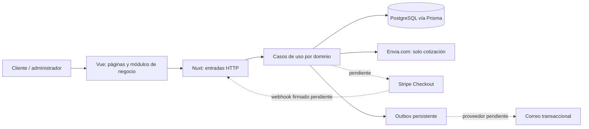
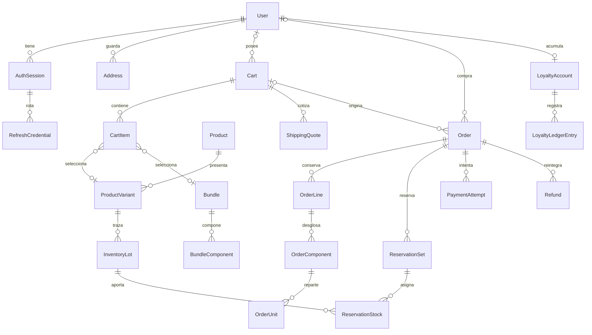

# Arquitectura de The Fitness Stuff (#32)

Versión 1, 13 de octubre de 2026. Este documento describe la versión local del repositorio; distingue capacidades ejecutables de contratos pendientes. Fuentes de decisiones: [#32](https://github.com/YaelQCI/ComercioElectronico/issues/32), [modelo revisado #33](database-model-source.md) y reglas de [AGENTS.md](../AGENTS.md).

## Tecnologías y ejecución

Una aplicación Nuxt integra interfaz Vue, renderizado inicial SSR, navegación cliente y API del servidor. No se necesita un proyecto backend separado. JavaScript con módulos ES es el lenguaje de aplicación; HTML semántico y Tailwind expresan presentación y accesibilidad. Los auxiliares TypeScript de Prisma generan acceso tipado sin cambiar el lenguaje del negocio.

| Tecnología | Versión fijada | Responsabilidad / razón |
| --- | --- | --- |
| Node.js | 24.12.0, rama 24 | Ejecutar Nuxt, herramientas y cliente Prisma generado |
| Nuxt / Vue | 4.5.2 / 3.5.44 | SSR, rutas, estados interactivos y API en una aplicación |
| Tailwind CSS / plugin Vite | 4.3.3 | Utilidades semánticas y tokens centralizados, sin duplicar colores |
| PostgreSQL | 17.7 en Compose | Relaciones, restricciones y transacciones para stock/pedidos |
| Prisma / adapter-pg | 7.10.0 | Consultas desde servidor y migraciones versionadas |
| Stripe | Integración pendiente #30 | Checkout alojado propuesto para tarjetas; captura fuera de la tienda |
| Envia.com | Cliente de cotización existente #44 | Consultar tarifas; nunca generar guías ni envíos |
| AWS / Route 53 | Servicios pendientes #41 | Alojamiento, PostgreSQL, DNS y HTTPS; no hay recursos aprovisionados |
| Git / npm | Lockfile versionado | Historial y dependencias reproducibles |

La configuración del proveedor no autoriza cobrar ni desplegar. La selección de servicios AWS, región y dominio permanece en #41. Se propone Checkout alojado para reducir captura de datos sensibles; #30 debe verificar y documentar su modalidad definitiva.

## Módulos y flujo



| Ruta | Responsabilidad |
| --- | --- |
| `app/pages/` | Punto de entrada que compone vistas, metadatos y navegación |
| `app/features/catalog`, `cart`, `shipping`, `restock`, `appearance` | Interfaz por capacidad del negocio |
| `server/api/` | Recibir petición y delegar al módulo correspondiente |
| `server/features/catalog`, `cart`, `inventory`, `coupons`, `shipping`, `restock` | Casos de uso y acceso a datos del dominio |
| `shared/features/` | Reglas puras compartidas: importes, lotes, filtros, envío y elegibilidad |
| `app/components`, `layouts` | Controles, cabecera/pie y composición reutilizados |
| `server/utils/database.js` | Infraestructura común: pool Prisma, máximo cinco conexiones y timeout |
| `prisma/` | Esquema físico y migraciones; restricciones SQL complementarias |
| `scripts`, `tests`, `docs` | Operaciones, evidencia reproducible y decisiones |

Las reglas puras reciben datos explícitos, sin importar Vue, HTTP ni Prisma. Prisma y proveedores se encapsulan en el dominio que los usa. `shared/features` es una adaptación intencional: contiene reglas utilizadas tanto en servidor como en interfaz; no es un depósito de infraestructura.

## Diseño de datos

El diccionario completo está en [modelo revisado](database-model-source.md); el esquema ejecutable en [schema.prisma](../prisma/schema.prisma) y los detalles físicos en [migraciones](database-migrations.md).



IDs internos UUID y claves de negocio únicas (correo normalizado, SKU, códigos); soft delete conserva unicidad e historia. No usar correo o número público del pedido como autorización. Importes en centavos enteros y puntos en décimas enteras; las respuestas JSON convierten BigInt a cadenas para evitar pérdida. Pedidos deben conservar snapshots de comprador, dirección, composición, lotes, importes y cotización: cambiar catálogo o perfil no altera compras anteriores.

Las claves compuestas y triggers de la migración protegen pertenencia entre pedido, reservas, pagos y reintegros. Consultar [inventario](inventory-reservations.md) y [cupones](coupons.md). Nuevos cambios de esquema requieren nuevas migraciones; las aplicadas no se reescriben.

## Contratos y autorización

| Interacción | Entrada / salida | Protección |
| --- | --- | --- |
| Catálogo | Búsqueda, filtros, página; productos publicados y paginación | Solo lectura, sin base ni secretos en navegador |
| Carrito | IDs, cantidad y versión; resumen recalculado | Cookie opaca HttpOnly y SameSite=Strict, Secure fuera de desarrollo, hash persistido; origen y control de versión en mutaciones |
| Envío | Destino y carrito; opciones/cotización elegida | Validación de servidor, snapshot y huella de entradas; rutas externas limitadas a cotización |
| Reposición | Correo, variante y consentimiento | Validación, suscripción deduplicada y cancelación opaca; proveedor de correo pendiente |
| Cuenta (#23 pendiente) | Correo/contraseña; perfil sin hashes ni tokens en JSON | JWT 15 min en cookie HttpOnly/Secure; sesión revocable hasta 7 días y renovación rotatoria |
| Checkout (#24 pendiente) | Datos de entrega y aceptación de importes; pedido | Propiedad, revalidación completa, idempotencia y reserva conjunta de 30 min |
| Stripe (#30 pendiente) | Importe desde pedido; sesión/referencia proveedor | Idempotencia, firma sobre cuerpo original, correspondencia de pedido/moneda/importe |
| Administración (#34 pendiente) | Cambios de negocio con motivo | Rol administrador revalidado en servidor y auditoría; no edición directa de saldos |

Registro público siempre crea cliente. Revocación se comprueba además de la firma del JWT. Cambio de contraseña/desactivación invalidan acceso anterior. Recuperación usa token de un uso de 30 minutos; vinculación de compra invitada exige verificar control del correo. Son contratos acordados, todavía no implementados en este commit.

### Entradas HTTP existentes

Los handlers delegan en sus módulos; los archivos ejecutables se encuentran bajo `server/api`. Esta lista describe endpoints actuales, sin anunciar rutas de cuentas/pagos aún inexistentes.

| Método y ruta | Contrato |
| --- | --- |
| `GET /api/health` | Estado de conexión; 503 controlado si falta configuración o PostgreSQL |
| `GET /api/catalog/products`, `/api/catalog/products/:id` | Listado filtrado/paginado y detalle publicado |
| `GET /api/catalog/home`, `/api/catalog/recommendations`, `/api/catalog/bundles` | Selección y relaciones configuradas; sin productos comerciales inventados |
| `GET /api/catalog/lots/:id/certificate` | Certificado del lote visible, si está disponible |
| `GET /api/cart` | Carrito de la cookie visitante; vacío cuando no hay identidad |
| `POST /api/cart/items`, `PATCH /api/cart/items`, `DELETE /api/cart/items` | Añadir, editar o quitar; IDs/cantidad/versión, propiedad y recálculo en servidor |
| `POST /api/cart/saved`, `/api/cart/coupon` | Mover guardados o aplicar/retirar cupón; versión y validación de negocio |
| `POST /api/shipping/quotes`, `/api/shipping/selected` | Cotizar destino o elegir opción vinculada al carrito |
| `GET /api/shipping/selected` | Recuperar cotización seleccionada para la cookie visitante |
| `POST /api/restock`, `/api/restock/cancel` | Registrar interés con consentimiento o cancelar mediante token opaco |

Carrito y envío son actualmente de visitante: la integración del propietario autenticado queda para #23. No confiar en IDs del navegador para conceder propiedad. Mutaciones de carrito, envío y reposición comprueban `Origin`; respuestas privadas usan `Cache-Control: no-store`. Entradas inválidas producen 400; origen ajeno, 403; recursos no disponibles, 404; conflictos de stock/versión, 409; dependencia no disponible, 503 según el módulo. No serializar trazas internas ni URL de conexión al cliente. Los importes enviados por la interfaz no constituyen autorización para cobrar.

Las operaciones de catálogo no reservan inventario. Iniciar pago debe reservar FEFO, cupón y puntos atómicamente; la confirmación consume una vez. Estado operativo, cobro y reembolso permanecen independientes. Total cero se confirma localmente sin inventar pago Stripe. Puntos se acreditan al entregar, no al confirmar cobro.

No llamar proveedores de red manteniendo transacciones/bloqueos de inventario. Persistir intento/clave idempotente y conciliar con trabajador recuperable. Liberar recursos solo tras comprobar que el proveedor no cobró; incertidumbre mantiene reconciliación. Inbox/outbox permiten reintentos y deduplicación. La cola de reposición existe; trabajadores de pagos y vencimiento requieren implementación posterior.

## Entornos y arranque

Seguir [README](../README.md) para instalar, migrar y ejecutar. `npm ci` conserva lockfile; `npm run build` produce servidor Node y `npm run start` lo ejecuta. Una exportación estática no cubre API/webhook/autenticación.

Arranque local con Node 24.12.0 y PostgreSQL configurado, desde PowerShell:

```powershell
if (!(Test-Path -LiteralPath .env)) { Copy-Item .env.example .env }
npm.cmd ci
docker compose up -d --wait postgres
npm.cmd run db:deploy      # Aplicar migraciones revisadas a la base local elegida.
npm.cmd run db:check
npm.cmd run dev
```

La copia no debe sobrescribir un `.env` existente. El catálogo real se carga mediante `catalog:import` siguiendo [el procedimiento de importación](catalog-import.md); `db:seed` no inventa un catálogo y permanece bloqueado si faltan los datos aprobados. Las referencias visuales no son datos de venta.

`.env.example` documenta variables sin secretos comerciales. `DATABASE_URL`, Stripe, Envia.com y secretos de tokens son privados; solo contacto y clave publicable Stripe usan configuración pública. Desarrollo, pruebas aisladas y producción requieren bases, claves y URLs independientes; no reutilizar pagos live para pruebas. HTTPS, secretos gestionados, privilegios mínimos, respaldos y DNS se concretan en #41.

| Entorno | Datos y configuración | Ejecución |
| --- | --- | --- |
| Desarrollo | `.env` ignorado; PostgreSQL local persistente; Envia `test` si hay token; Stripe de prueba cuando se implemente | `npm run dev`; cookies Secure desactivadas por `import.meta.dev` para HTTP local |
| Pruebas | `TEST_DATABASE_URL` exclusiva `fitness_migration_test*`; fixtures explícitas y dobles de proveedores; `TEST_HTTP_URL` local para navegador | Pruebas de catálogo/precios sin BD; `test:database` solo contra base aislada; nunca cobros live |
| Producción (pendiente #41) | Secretos inyectados fuera de Git, PostgreSQL privado, HTTPS y URLs oficiales; claves Stripe live solo tras validación | Migraciones con `db:deploy`, build servidor y `npm run start`; cookies Secure requieren HTTPS |

La configuración del entorno no activa una integración inexistente. Las variables actuales incluyen `NUXT_ENVIA_TOKEN`, `NUXT_ENVIA_ENVIRONMENT`, `NUXT_ENVIA_CARRIER`, `NUXT_RESTOCK_TOKEN_SECRET`, `NUXT_CATALOG_ASSET_DIRECTORY`, `RESTOCK_SITE_URL`, `NUXT_STRIPE_SECRET_KEY` y `NUXT_STRIPE_WEBHOOK_SECRET`; sus valores privados se configuran localmente. Clave publicable y contacto usan `NUXT_PUBLIC_*`. Secretos de autenticación/URLs de retorno se definirán al implementar #23/#30, sin declarar variables ya consumidas cuando todavía no lo están.

No se ejecutan migraciones al atender una petición. Aplicarlas como paso explícito y revisado del despliegue, antes de arrancar la nueva versión. El servidor falla con mensaje controlado si una dependencia no está configurada. Las pruebas de integración exigen base `fitness_migration_test*`; no utilizan la base comercial.

## Estado y validación

La base Nuxt/Prisma y catálogo/carrito/envío/reposición son ejecutables; la documentación de cada módulo enumera límites operativos. El esquema contiene entidades de cuentas/pedidos/posventa, pero tener tablas no implementa sus casos de uso. Stripe, cuentas, checkout y administración siguen pendientes en este punto. No hay catálogo comercial definitivo, proveedor de correo, credenciales Stripe ni despliegue AWS configurados por el propietario.

En esta revisión: instalación reproducible y build correctos con Node 24.12.0; contratos contrastados con handlers/repositorios y esquema; enlaces locales del documento comprobados. No se realizó despliegue cloud ni compra. #29/#36/#39 deben mantener evidencia del flujo completo y seguridad conforme avance la implementación.

La instalación y el build corresponden a la validación ejecutada para #22 sobre esta misma base de código. Este cambio añade documentación y su enlace en README. Comprobaciones de esta revisión: nueve enlaces locales resuelven, las 22 entidades y 23 relaciones del diagrama existen en `schema.prisma`, los 18 handlers API documentados existen, y las versiones coinciden con `package.json`. Se revisó la separación pública/privada contra `nuxt.config.js` y `.env.example`; `git diff --check` pasó. No se repitió el build para un cambio exclusivamente documental ni se ejecutaron pruebas de BD sin una base aislada configurada.

## Criterios del issue #32

| Criterio | Evidencia entregada |
| --- | --- |
| Tecnologías/lenguajes y razones | Tabla del stack, aplicación Nuxt integrada y límites de AWS/Route 53 |
| Módulos, responsabilidades e intercambio de datos | Diagrama de flujo y estructura por capacidades de negocio |
| Diseño de datos con entidades, claves y relaciones | Diagrama relacional, convenciones físicas y vínculos al esquema/diccionario/migraciones de #33 |
| Entornos, estructura y arranque | Contratos de carpetas, matriz de entornos, comandos y README |
| Contratos y autorización sin secretos | Matriz de capacidades, rutas existentes, propiedad/origen y diseño de autenticación/pagos pendientes |

Estos cinco criterios de diseño/documentación quedan cubiertos. Selección concreta y despliegue AWS (#41), autenticación (#23), checkout (#24) e integración Stripe (#30) conservan su alcance y criterios de implementación; completarlos no se presupone para declarar entregado el diseño inicial de #32.
