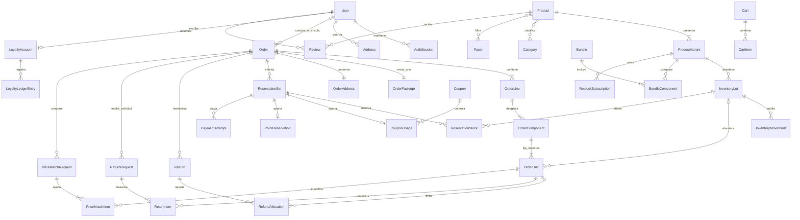

Parte de #1. Especificación revisada el 13 de octubre de 2026 con las decisiones confirmadas del equipo.

## Objetivo
Implementar el modelo integral en PostgreSQL mediante Prisma, conservando trazabilidad de catálogo, usuarios/invitados, inventario, pedidos, pagos y posventa. Requisito académico de Final Project.docx: diseño inicial en Parcial 1, persistencia en Parcial 2 e integración completa en Parcial 3; rúbrica de datos 15%.

## Criterios de aceptación
- [ ] Traducir el diccionario siguiente a esquema físico con claves, relaciones, índices y restricciones; incluir SQL versionado para las que requieran soporte adicional.
- [ ] Coordinar con #43 una primera migración de negocio integral, revisada antes de aplicarla; no crear tablas comerciales descartables. Conservar migraciones posteriores sin reescribir las ya aplicadas.
- [ ] Cargar al menos 10 productos distintos, con variantes/lotes/categorías y datos demostrables; variantes no sustituyen productos diferentes.
- [ ] Integrar lectura y escritura de tienda/administración desde servidor Nuxt; carritos y pedidos sobreviven a recargas y reinicios.
- [ ] Implementar transacciones, snapshots, restricciones de pertenencia e idempotencia del modelo, incluidos total cero, compensaciones y carreras de reserva/pago.
- [ ] Envia.com exclusivamente para cotizaciones: nunca generar, comprar ni emitir guías ni crear envíos/recolecciones.
- [ ] Ejecutar los escenarios de aceptación del modelo en PostgreSQL, incluyendo concurrencia y recuperación; documentar migraciones, respaldo/restauración y evidencia.
- [ ] Mantener modelo y decisiones concordantes con los issues funcionales. Esta revisión de diseño no marca la implementación como terminada.

## Dependencias y coordinación
#43 prepara proyecto/conexión/herramientas; este issue implementa el esquema de negocio. Coordinar #3/#13, #14–#21, #23–#28, #30, #34–#36 y #44. Arquitectura #32 y evidencia #39. La revisión del modelo precede a la migración inicial; los módulos funcionales utilizan esa misma base.

## Modelo revisado completo
El contenido siguiente es la copia publicada de modelo-base-de-datos.md; las referencias a documentos locales identifican fuentes, no archivos ya publicados en el repositorio.

# Modelo de datos de The Fitness Stuff

Revisión del 13 de octubre de 2026. Especificación para PostgreSQL y Prisma; la aplicación y las migraciones todavía no están implementadas. Fuente de reglas aprobadas: `decisiones-base-de-datos.md`. Cobertura funcional: páginas estáticas y issues #1–#44 de `YaelQCI/ComercioElectronico`.

El objetivo es preparar una migración inicial de negocio coherente, después de configurar el stack en #43. No se puede garantizar que nunca harán falta migraciones: los cambios futuros se versionarán, sin modificar migraciones que ya hayan sido aplicadas en un entorno compartido.

## 1. Resultado de la revisión

El modelo cubre cuentas e invitados, categorías y filtros, variantes, galerías y certificados, inventario por lote, carritos y guardados, combos fijos, cupones, cotizaciones, pedidos, tarjetas Stripe, puntos, devoluciones, Price Match, reseñas, reposición y administración. El esquema conserva operaciones e importes históricos aunque cambie el catálogo, la dirección o el estado de una cuenta.

Las decisiones comerciales de esta ronda están cerradas. Las siguientes son resoluciones técnicas para aplicar esas reglas; no constituyen nuevas promociones ni servicios:

| Situación detectada | Resolución técnica |
|---|---|
| Un paquete por pedido y cantidades sin límite comercial | Verificar cabida física, peso permitido y cobertura antes de pagar. Si ninguna caja/servicio admite el pedido completo, mostrar error recuperable. Se puede corregir el pedido o configurar una caja apropiada; no dividir automáticamente, inventar tarifa ni cobrar un pedido sin cotización válida. |
| Cubrir el 100% con puntos y precios con centavos | Guardar saldo y canjes en **décimas de punto** enteras: 1 punto = 10 décimas = 10 centavos MXN; 1 décima = 1 centavo. Las ganancias siguen siendo puntos completos, redondeados hacia abajo. Las reglas aprobadas no limitaban los canjes a puntos enteros. |
| Price Match proporcional y centavos indivisibles | Prorratear en centavos con método de mayores restos y desempate estable, registrando dinero y décimas de punto por unidad. Ningún medio devuelve más de lo originalmente aplicado a esa unidad menos devoluciones previas o comprometidas. |
| Pago que llega al vencer la reserva | Serializar confirmación y liberación, reconciliar el estado del proveedor, y no liberar mientras la situación de pago sea incierta. Un cobro excepcional posterior a una liberación no habilita sobreventa: requiere compensación idempotente y estado visible. |
| Soft delete y reutilización de correo/SKU | Conservar unicidad global de correo normalizado, SKU y códigos estables aunque haya desactivación. Reactivar mediante flujo autorizado; no crear una identidad diferente sobre datos históricos. |
| Pedido de total cero | Confirmar y consumir inventario, cupón y puntos en una transacción local, con estado monetario `NOT_REQUIRED`; no crear una operación Stripe ficticia. |
| Cupón de alcance limitado que admite combos | Evaluar elegibilidad sobre sus componentes y aplicar el cupón a sus importes prorrateados, una sola vez. `allowBundles` no vuelve elegibles componentes ajenos al alcance. |

La configuración operativa pendiente —dirección real del almacén, medidas de productos/cajas, certificados, contenido de políticas/contacto, proveedor de correo, servicios AWS y versiones compatibles— es carga de datos o implementación de los issues existentes. No exige reabrir el diseño de tablas. Los tiempos de entrega fijos, precios de muestra y reseñas de la maqueta no se convierten en datos reales automáticamente.

## 2. Convenciones comunes

- Claves primarias `id` UUID generadas en servidor; claves naturales únicas separadas (`sku`, código, correo normalizado). Tablas puente pueden utilizar clave primaria compuesta.
- Campos comunes cuando corresponde: `createdAt`, `updatedAt`; `deletedAt` para productos, variantes, combos y cuentas desactivables. Tiempos en UTC con `timestamptz`; el almacén guarda su zona horaria para fechas locales.
- Importes monetarios: enteros `BIGINT` en **centavos MXN**, nunca coma flotante. `currency = MXN` en pedidos, pagos, cotizaciones y reembolsos de esta versión. En la frontera JSON, serializar los enteros grandes como texto o convertirlos solo tras verificar rango seguro.
- Dimensiones logísticas: enteros positivos en milímetros. Peso del producto empacado y de la caja: enteros positivos en gramos. Convertir a las unidades requeridas por el proveedor solamente en su adaptador.
- Cantidades de venta/inventario: enteros; ninguna restricción comercial adicional al stock. Comprobar desbordamientos y límites técnicos de almacenamiento sin introducir un tope arbitrario de compra.
- Datos nutrimentales y contenidos pueden necesitar fracciones: usar decimal exacto con unidad explícita o miligramos enteros, separados de los gramos enteros de logística. No redondear una medida nutrimental para cotizar transporte.
- `emailNormalized` y códigos de comparación tienen normalización documentada y estable; conservar texto original para mostrar. No suprimir puntos ni etiquetas `+` de correos, pues podrían alterar identidad.
- Todas las FK históricas usan `RESTRICT`/`NO ACTION` al eliminar; no cascada destructiva desde usuario, producto o lote hacia ventas, pagos, ajustes o reseñas. Cascadas solo en datos auxiliares sin valor histórico cuando sean apropiadas.
- JSON se reserva para snapshots de proveedor y contenido flexible validado; claves, cantidades, dinero, estados y relaciones críticas son columnas tipadas. No sustituir relaciones por listas de identificadores dentro de JSON.
- Nunca persistir contraseña, JWT de renovación, token de recuperación ni token de acceso a pedido en claro. Guardar hashes de secretos; no almacenar PAN/CVC ni claves de servicios en estas tablas.
- La autorización y las transacciones se ejecutan en API/servidor Nuxt. Las restricciones SQL complementan esa validación. Restricciones no representables en la versión elegida de Prisma se incluyen explícitamente en SQL versionado de la migración.

## 3. Cuentas, sesiones y direcciones

| Tabla | Campos clave | Relaciones y restricciones |
|---|---|---|
| `User` | `id`, `email`, `emailNormalized`, `passwordHash`, `displayName`, `phone?`, `role`, `emailVerifiedAt?`, `authVersion`, `deletedAt?` | Correo normalizado único global. `role` = `CUSTOMER`/`ADMIN`; registro público siempre `CUSTOMER`. El cliente no escribe `role`, verificación ni `authVersion`. |
| `AuthSession` | `id`, `userId`, `tokenFamilyId`, `createdAt`, `absoluteExpiresAt`, `lastUsedAt`, `revokedAt?`, `revocationReason?` | Usuario 1:N sesiones. Expiración absoluta a los 7 días. JWT de acceso de 15 minutos contiene `sessionId` y versión; validar revocación/usuario activo en servidor. |
| `RefreshCredential` | `id`, `sessionId`, `tokenHash`, `expiresAt`, `consumedAt?`, `revokedAt?`, `replacedById?` | Sesión 1:N credenciales rotadas. Hash único. Conservar hashes consumidos hasta terminar la familia para detectar reutilización; consumir y crear reemplazo atómicamente, sin ampliar vencimiento absoluto de sesión. |
| `ActionToken` | `id`, `purpose`, `tokenHash`, `emailNormalized`, `userId?`, `orderId?`, `expiresAt`, `consumedAt?`, `attemptCount` | Hash único. Propósitos tipados: verificar correo, recuperar contraseña, acceso de invitado a pedido. Recuperación dura 30 minutos, una sola consumición atómica. FK y `CHECK` según propósito; acceso a pedido queda limitado al pedido/correo verificado. |
| `Address` | `id`, `userId`, `label?`, `recipientName`, `phone`, `countryCode`, `postalCode`, `state`, `city`, `district`, `street`, `exteriorNumber`, `interiorNumber?`, `references?`, `isDefault` | Usuario 1:N direcciones. Índice único parcial sobre `userId WHERE isDefault`; cambiar predeterminada en transacción. Eliminar/editar una dirección no modifica `OrderAddress`. |

Desactivar cuenta incrementa `authVersion` y revoca sesiones en la misma operación; los pedidos y el ledger conservan su dueño. Verificar un correo no habilita adoptar pedidos de otra dirección ni permite recuperar una cuenta desactivada por crear otra. Vincular pedidos de invitado exige `User.emailVerifiedAt` vigente para el mismo correo normalizado, bloqueo de pedido y trazabilidad de `linkedAt`; una repetición no acredita puntos dos veces.

Los invitados necesitan demostrar control del correo para consultar/cancelar un pedido o solicitar posventa. Conocer un número de pedido no da autorización. Este uso de `ActionToken` completa las funciones de invitado sin crear una cuenta obligatoria.

## 4. Catálogo, contenidos de producto y combos

| Tabla | Campos clave | Relaciones y restricciones |
|---|---|---|
| `Brand` | `id`, `name`, `slug`, `isActive` | Slug único; marca 1:N productos. |
| `Category` | `id`, `parentId?`, `name`, `slug`, `position`, `isActive` | Árbol de categorías/subcategorías. Slug único; prohibir ciclos y padre igual al propio nodo. |
| `Product` | `id`, `brandId?`, `name`, `slug`, `description`, `usageInstructions?`, `ingredients?`, `allergenInformation?`, `featuredPosition?`, `publishedAt?`, `deletedAt?` | Slug único. Producto 1:N variantes; el mínimo académico es 10 productos diferentes. Un producto desactivado impide vender todas sus variantes. |
| `ProductCategory` | `productId`, `categoryId`, `isPrimary` | PK compuesta; N:M. A lo sumo una categoría principal por producto mediante índice parcial; otras alimentan filtros. |
| `Facet` | `id`, `kind`, `name`, `slug`, `position` | `kind` = `GOAL`/`DISCIPLINE`; único `(kind, slug)`. Objetivos y disciplinas son filtros transversales. |
| `ProductFacet` | `productId`, `facetId` | PK compuesta; N:M sin duplicados. |
| `ProductVariant` | `id`, `productId`, `sku`, `flavor`, `presentationLabel`, `contentAmount`, `contentUnit`, `servings?`, `servingAmount?`, `servingUnit?`, `nutritionData?`, `ingredientsOverride?`, `priceCents`, `compareAtPriceCents?`, `priceVersion`, `weightGrams`, `lengthMm`, `widthMm`, `heightMm`, `deletedAt?` | SKU único global y combinación normalizada de sabor/presentación única dentro del producto. Precio no negativo; anterior opcional mayor al vigente; porciones positivas cuando aplica. Cada variante posee precio y lotes propios. Nutrientes estructurados validados y unidad por valor. |
| `MediaAsset` | `id`, `storageKey`, `mimeType`, `byteSize`, `checksum`, `originalName?`, `createdById?` | Referencia a archivo; no guardar imágenes/PDF binarios dentro de cada pedido. Validar acceso, formato y existencia. |
| `ProductMedia` | `id`, `productId`, `variantId?`, `assetId`, `kind`, `altText`, `position` | Producto 1:N medios; variante opcional debe pertenecer al producto. Tipos frontal, nutrimental, galería. Orden estable; alt obligatorio para imagen informativa. |
| `ProductRelation` | `sourceProductId`, `targetProductId`, `kind`, `position` | PK compuesta `(sourceProductId, targetProductId, kind)`; no autorrelación. Tipos relacionados/venta cruzada, sin personalización inventada. |
| `Bundle` | `id`, `code`, `slug`, `name`, `description?`, `priceCents`, `compositionVersion`, `imageAssetId?`, `featuredPosition?`, `deletedAt?` | Código/slug únicos. Precio propio; una composición fija activa. No inventario separado. |
| `BundleComponent` | `bundleId`, `variantId`, `quantity` | PK `(bundleId, variantId)`, cantidad positiva; combo 1:N componentes. Un combo no contiene otro combo. |

Costo por porción se calcula con precio vigente y porciones, usando precisión exacta para comparar y dos decimales solo para mostrar. Stock, calificación media, conteos por categoría y ranking por ventas son consultas o proyecciones reconstruibles, no valores ficticios copiados del HTML. Destacados pueden configurarse sin afirmar que son los más vendidos.

Editar una composición o un precio incrementa versión. Pedidos ya creados conservan sus snapshots; un carrito se recalcula al consultar y al intentar pagar. El ahorro del combo compara el precio propio con la suma vigente de componentes sin descontarlo de nuevo. No existe un registro de existencias de combo.

## 5. Almacén, cajas e inventario por lote

| Tabla | Campos clave | Relaciones y restricciones |
|---|---|---|
| `Warehouse` | `id`, `singletonKey`, `name`, campos de dirección de origen, `contactName`, `phone`, `timezone`, `configurationVersion` | `singletonKey = 1`, único y con `CHECK`, para un solo almacén. Dirección configurable; cada cotización conserva copia independiente. |
| `PackageType` | `id`, `code`, `innerLengthMm`, `innerWidthMm`, `innerHeightMm`, `outerLengthMm`, `outerWidthMm`, `outerHeightMm`, `tareWeightGrams`, `maxGrossWeightGrams?`, `isActive`, `version` | Código único. Dimensiones interiores permiten verificar cabida; exteriores se cotizan. Valores positivos y dimensiones interiores no mayores a exteriores. |
| `InventoryLot` | `id`, `variantId`, `warehouseId`, `lotCode`, `expiresOn?`, `expiryPrecision?`, `importedOn?`, `customsEntry?`, `origin?`, `certificateAssetId?`, `onHandQty`, `reservedQty`, `nonSellableQty`, `isBlocked`, `version` | Único `(variantId, warehouseId, lotCode)`. Contadores no negativos, `reservedQty <= onHandQty`. Producto 1:N variantes 1:N lotes; lote conserva referencias y certificado. |
| `InventoryMovement` | `id`, `lotId`, `kind`, `onHandDelta`, `reservedDelta`, `nonSellableDelta`, `reason`, `actorId?`, `reservationStockId?`, `orderUnitId?`, `returnInspectionId?`, `idempotencyKey`, `createdAt` | Ledger inmutable; clave de evento única. Ajuste manual requiere administrador y motivo. Movimientos de sistema llevan causa verificable y actor `SYSTEM`; no falsificar un administrador. |

Existencias disponibles por variante = suma de `onHandQty - reservedQty` de lotes aptos, no bloqueados ni vencidos, con producto y variante activos. Las unidades no vendibles no contribuyen. `onHandQty` representa unidades físicas del conjunto apto, incluidas las reservadas; una venta decrementa `onHandQty` y `reservedQty` conjuntamente. Reservar solo incrementa `reservedQty`; liberar solo lo decrementa. Los contadores son proyecciones del ledger y se actualizan en la misma transacción que el movimiento.

FEFO ordena por caducidad, después recepción/identificador estable. Lotes de artículos que no caducan pueden usar `expiresOn = NULL` y se ordenan al final. Para fechas impresas solo con mes/año, guardar la precisión y el último día de ese mes; no mostrar una precisión inexistente. Vencido significa que terminó su fecha de caducidad en la zona del almacén. Si un lote vence o se bloquea mientras tiene reserva, reconciliar la reserva antes de sustituir lotes; nunca enviar un lote vencido o cambiar un snapshot vendido silenciosamente.

Mostrar últimas piezas de 1 a 5 disponibles, agotado en cero. Componentes de combos y unidades sueltas se agregan por variante antes de reservar. Ajustar inventario no puede bajar unidades físicas por debajo de las reservadas; requiere resolver las reservas afectadas. Registrar mermas/caducidad y recepción de devolución con movimientos explícitos. Un retorno apto incrementa `onHandQty` del lote original; uno no apto incrementa `nonSellableQty`.

La cabida en una caja exige un plan de empaquetado comprobable. Comparar solamente volúmenes no demuestra que los artículos quepan. Conservar dimensiones, orientaciones permitidas y resultado de disposición en el snapshot del paquete. Si el algoritmo conservador no encuentra disposición, rechaza la cotización de manera recuperable; no cobra usando dimensiones subestimadas.

## 6. Carrito, guardados y cotizaciones

| Tabla | Campos clave | Relaciones y restricciones |
|---|---|---|
| `Cart` | `id`, `userId?`, `guestTokenHash?`, `status`, `version`, `selectedCouponId?`, `createdAt`, `updatedAt` | Dueño usuario o secreto de invitado, con `CHECK` de exclusión. Un carrito activo por usuario; token visitante único. `status` = `ACTIVE`/`MERGED`/`CONVERTED`/`ABANDONED`. |
| `CartItem` | `id`, `cartId`, `variantId?`, `bundleId?`, `quantity`, `state`, `position` | Exactamente variante o combo. `state` = `ACTIVE`/`SAVED`; únicas parciales por carrito, objetivo y estado. Cantidad positiva. Guardados no suman totales ni reservas. |
| `ShippingQuote` | `id`, `cartId?`, `orderId?`, `requestFingerprint`, `provider`, `providerQuoteId?`, `carrierCode`, `serviceCode`, `serviceName`, `quotedAmountCents`, `currency`, `estimatedDeliveryFrom?`, `estimatedDeliveryTo?`, `quotedAt`, `expiresAt?`, `originSnapshot`, `destinationSnapshot`, `packageSnapshot`, `sanitizedResponse`, `status` | Varias alternativas por solicitud. Clave externa única cuando exista; huella incorpora dirección, contenido, cantidades, dimensiones, empaque y versiones. No suponer vencimiento/fecha que el proveedor no informe. |

Carrito persistido en servidor; cookie opaca identifica invitado. Al iniciar sesión, fusionar ambos carritos de forma transaccional, combinar artículos iguales y revalidar existencias/precios; conservar guardados y mantener un solo cupón. Si hay dos cupones incompatibles, conservar el del carrito autenticado e informar el cambio; el cliente puede reemplazarlo antes de pagar. Esto es resolución de colisión técnica, no cupón adicional. El carrito no garantiza stock ni reserva puntos.

Seleccionar cotización no inicia envío. Solo se permiten operaciones de cotización y consultas auxiliares de lectura necesarias; **nunca generar, comprar ni emitir guía, ni crear envío o recolección mediante Envia.com**, en pruebas o producción, UI, administración, tareas o webhooks. No existe tabla ni campo cuya ejecución implique generar una guía Envia.

Recalcular el paquete y recotizar al cambiar destino o contenido. Antes de iniciar pago, validar nuevamente la tarifa y el servicio; si cambia el cargo, obtener nueva aceptación antes de reservar/cobrar. Guardar `acceptedQuoteId`, `acceptedAt` y huella de compra en la reserva/pedido. El intento de pago utiliza esa versión inmutable. Cambiar una dirección durante un pago exige cancelar/reconciliar el intento y crear otro, sin modificar la sesión que ya puede pagarse.

Un pedido tiene un paquete. Una cotización no prueba una fecha garantizada; mostrar el plazo del servicio, con datos disponibles. Falta de cobertura, servicio caído, caja insuficiente o tarifa caducada son errores recuperables y no habilitan la antigua tarifa fija de $149.

## 7. Pedidos, snapshots y reservas

| Tabla | Campos clave | Relaciones y restricciones |
|---|---|---|
| `Order` | `id`, `orderNumber`, `userId?`, `buyerEmail`, `buyerEmailNormalized`, `buyerName`, `linkedAt?`, `sourceCartId?`, `status`, `moneyStatus`, `currency`, `goodsBeforeCouponCents`, `couponDiscountCents`, `goodsAfterCouponCents`, `pointsAppliedTenths`, `goodsMoneyCents`, `shippingQuotedCents`, `shippingChargedCents`, `shippingSubsidyCents`, `totalMoneyCents`, `couponId?`, `couponSnapshot?`, `policySnapshot`, `pricingVersion`, `confirmedAt?`, `shippedAt?`, `deliveredAt?`, `canceledAt?` | Número único. Usuario opcional para invitados, correo histórico obligatorio. Totales no negativos y sumas coherentes; puntos nunca financian envío. Estado operativo independiente de monetario. |
| `OrderAddress` | `id`, `orderId`, `sourceAddressId?`, campos completos de destinatario/dirección | Pedido 1:1 dirección inmutable, `orderId` único. FK a dirección fuente puede ser nula/eliminarse sin perder copia. |
| `OrderPackage` | `id`, `orderId`, `packageTypeId?`, `quoteId`, `warehouseId`, `originSnapshot`, `packageCodeSnapshot`, `weightGrams`, dimensiones externas, `packingPlanSnapshot`, `carrierSnapshot`, `serviceSnapshot`, `deliveryEstimateSnapshot`, `acceptedAt` | `orderId` único: un paquete por pedido. Snapshot de caja, origen, tarifa, servicio y cálculo; cambios de configuración posteriores no lo alteran. |
| `OrderLine` | `id`, `orderId`, `position`, `variantId?`, `bundleId?`, `kind`, `quantity`, `nameSnapshot`, `skuOrCodeSnapshot`, `unitPriceCents`, `lineBeforeCouponCents`, `couponDiscountCents`, `lineAfterCouponCents`, `compositionVersionSnapshot?` | Exactamente variante o combo según tipo. Cantidad positiva. Renglón comercial conserva lo que vio el comprador; total del combo se cobra una vez. |
| `OrderComponent` | `id`, `orderLineId`, `variantId`, `quantityPerLineUnit`, `totalQuantity`, `productSnapshot`, `variantSnapshot`, `referenceUnitPriceCents`, `allocatedBaseCents`, `allocatedCouponCents`, `allocatedNetCents` | Línea normal tiene un componente; combo tiene su composición fija copiada. Único `(orderLineId, variantId)`. Total de componentes concuerda con línea. |
| `OrderUnit` | `id`, `orderComponentId`, `unitOrdinal`, `lotId?`, `lotSnapshot?`, `baseCents`, `couponCents`, `netGoodsCents`, `pointsTenths`, `moneyCents`, `returnedAt?` | Único `(orderComponentId, unitOrdinal)`. Una fila por unidad física adquirida para conservar reparto exacto de centavos, lote y devoluciones. `moneyCents + pointsTenths = netGoodsCents`; el ordinal es estable. Lote obligatorio al reservar/confirmar. |
| `ReservationSet` | `id`, `orderId`, `attemptNumber`, `state`, `createdAt`, `expiresAt`, `resolvedAt?`, `acceptedQuoteId`, `checkoutFingerprint`, `acceptedCheckoutSnapshot`, `idempotencyKey`, `resolutionReason?` | Pedido 1:N intentos, uno `ACTIVE`/`RECONCILING` a la vez. Único `(orderId, attemptNumber)` y clave de solicitud. Estados `ACTIVE`, `RECONCILING`, `CONSUMED`, `RELEASED`. Duración de pago 30 minutos; snapshot del intento conserva versión, importes y selección aceptados. |
| `ReservationStock` | `id`, `reservationSetId`, `lotId`, `quantity` | Único `(reservationSetId, lotId)`; cantidad positiva. Agrupa la demanda por lote de todas las unidades, incluidos combos. Relaciones con `OrderUnit` se verifican bajo bloqueo: mismos lotes/variante, suma igual a cantidad reservada. |
| `OrderStatusHistory` | `id`, `orderId`, `fromStatus?`, `toStatus`, `actorId?`, `actorType`, `reason?`, `eventKey`, `createdAt` | Historial inmutable, evento único. Toda transición aceptada queda registrada, incluida cancelación. |

Los `OrderUnit` facilitan la trazabilidad solicitada: una línea puede usar varios lotes y cada unidad puede participar en devolución o Price Match con sus importes originales. Su número depende de las unidades compradas, sin introducir un límite comercial. Las sumas de componentes, unidades y lotes deben comprobarse al crear/reservar el pedido y al cerrar transacciones de posventa.

Estados operativos: `PENDING_PAYMENT → CONFIRMED → PREPARING → SHIPPED → DELIVERED`; `CANCELED` es salida desde los estados anteriores a `SHIPPED`. No permitir saltos ni retrocesos arbitrarios. `confirmedAt` identifica la compra para el plazo de Price Match; `deliveredAt`, la entrega para devoluciones y puntos. Los cambios de pago/reembolso no reescriben por sí solos la entrega histórica.

`moneyStatus`: `PENDING`, `PAID`, `PARTIALLY_REFUNDED`, `REFUNDED`, `FAILED`, `NOT_REQUIRED`, con estado adicional de reconciliación si procede. Un pedido cancelado puede tener reembolso pendiente: el estado operativo no afirma que el dinero ya se devolvió.

## 8. Cupones y control de uso

| Tabla | Campos clave | Relaciones y restricciones |
|---|---|---|
| `Coupon` | `id`, `code`, `codeNormalized`, `kind`, `fixedAmountCents?`, `percentageBasisPoints?`, `startsAt?`, `endsAt?`, `minimumEligibleCents?`, `maxUses?`, `maxUsesPerCustomer?`, `allowOffers`, `allowBundles`, `scope`, `isActive`, `version` | Código normalizado único global. `kind` fijo/porcentaje con campos excluyentes; porcentaje de 1 a 10000 puntos base. Fechas coherentes, límites positivos si existen. `scope` catálogo/productos/categorías. |
| `CouponProduct` | `couponId`, `productId` | PK compuesta; productos incluidos solo cuando el alcance es productos. |
| `CouponCategory` | `couponId`, `categoryId` | PK compuesta; categorías incluidas solo cuando el alcance es categorías. Registrar categorías efectivamente elegibles al comprar; no recalcular históricos al recategorizar. |
| `CouponUsage` | `id`, `couponId`, `reservationSetId`, `orderId`, `identityKey`, `userId?`, `emailNormalizedSnapshot`, `state`, `expiresAt`, `consumedAt?`, `releasedAt?` | Único por reserva; estados reservado/consumido/liberado. Un uso consumido por pedido. Límites incluyen usos consumidos y reservas aún retenidas; controlar concurrencia con bloqueo del cupón y de identidad. |

Solo un cupón por pedido y su aplicación sustituye al anterior. Artículos no elegibles quedan a precio vigente; no cancelar ni modificar ofertas para forzar un cupón. El mínimo se evalúa sobre artículos elegibles antes del cupón, excluyendo envío. En combos permitidos, evaluar componentes sobre el precio propio ya distribuido. Si el precio de referencia tiene oferta y `allowOffers = false`, excluir ese componente. El descuento no excede la base elegible y nunca lleva un importe por debajo de cero.

Usar como identidad de límite el usuario verificado cuando exista, conciliando con sus usos de correo normalizado; los invitados se controlan por correo sin afirmar identidad verificada. No permitir eludir límites al vincular pedidos: resolver los usos previos del mismo correo en el conteo. La contabilización concreta se realiza en un servicio único, con bloqueo estable.

Al confirmar pedido se consume el uso, incluido total cero; al vencer/cancelar sin confirmar se libera. Una cancelación de pedido ya confirmado no borra su uso histórico. No se aprobó reactivar automáticamente cupones consumidos tras reembolso; cualquier concesión posterior requiere acción comercial explícita y auditada.

## 9. Puntos y cálculos monetarios

| Tabla | Campos clave | Relaciones y restricciones |
|---|---|---|
| `LoyaltyAccount` | `id`, `userId`, `balanceTenths`, `reservedTenths`, `version` | Usuario 1:1 cuenta, `userId` único. Saldo contable admite negativos; reservado no negativo. Disponible canjeable = máximo de cero y saldo menos reservas. |
| `LoyaltyLedgerEntry` | `id`, `accountId`, `orderId?`, `refundId?`, `kind`, `deltaTenths`, `balanceAfterTenths`, `idempotencyKey`, `actorId?`, `reason?`, `createdAt` | Ledger inmutable: ganancia, canje, restitución, reversión/ajuste. Clave única impide duplicados; saldo es proyección verificable. No caducidad. |
| `PointReservation` | `id`, `reservationSetId`, `accountId`, `amountTenths`, `state`, `expiresAt`, `consumedAt?`, `releasedAt?` | Una por reserva/cuenta; importe positivo. Reserva misma vigencia de 30 minutos; consumo/restitución se relaciona con el ledger. |

Unidad interna elegida: **1 décima de punto equivale a 1 centavo MXN**. Por ejemplo, $99.99 de productos pueden cubrirse con 999.9 puntos, representados por `9999` décimas; esto conserva la equivalencia aprobada de 1 punto = $0.10. La UI puede mostrar un decimal en saldo/canje cuando exista, sin redondear dinero ni perder fracciones.

Orden de cálculo, enteramente en servidor:

1. Precio vigente de cada variante o precio propio del combo; conservar precio anterior solo para mostrar ahorro. No restar oferta dos veces.
2. Prorratear base de combo según precios individuales vigentes de referencia. Si todos son cero, usar cantidades como ponderación determinista; registrar fórmula/versión y no dividir por cero.
3. Aplicar un cupón sobre los componentes elegibles. Repartir descuento primero por componente y luego por unidad con mayores restos. Cantidades netas nunca negativas.
4. Base de envío gratis = suma de productos después de ofertas/cupón, antes de puntos. Desde `149900` centavos, envío al cliente = cero y la tienda absorbe la cotización. Si no aplica, envío cobrado = cotizado, sin recargo.
5. Canjear hasta el menor entre saldo disponible solicitado y productos netos; repartir décimas de punto proporcionalmente sobre unidades con base positiva. Nunca aplicar puntos al envío.
6. `goodsMoneyCents = goodsAfterCouponCents - pointsAppliedTenths`; `totalMoneyCents = goodsMoneyCents + shippingChargedCents`. `shippingSubsidyCents = shippingQuotedCents - shippingChargedCents`.
7. Ganancia prevista = `floor(goodsMoneyCents / 1000)` puntos; internamente multiplicar por 10 décimas. El redondeo se realiza sobre el total del pedido, no por línea. Envío y productos cubiertos con puntos no generan puntos.

Para repartir `T` centavos por pesos `w_i`: asignar `floor(T*w_i/sum(w))`, y repartir los centavos restantes por mayor residuo, desempatando por posición/identificador/ordinal estable. Guardar el resultado; no recalcular una venta con precios actuales. La suma final es exactamente `T` y respeta capacidades de cada unidad/medio.

Para una compra realizada con cuenta, la acreditación ocurre al entregar el pedido. Para una compra de invitado requiere ambas condiciones: entrega confirmada y vinculación a una cuenta tras verificar control del correo de compra; da igual cuál ocurra primero. Esta regla no añade verificación de correo como requisito de puntos a todas las compras de cuentas existentes. Una clave única de ganancia por pedido evita duplicados. Tras reembolsos confirmados, recalcular ganancia objetivo sobre dinero de productos efectivamente retenido y registrar solo el ajuste de diferencia; aplica también a Price Match. No borrar la ganancia original. Si deja saldo negativo, se conserva y futuras ganancias lo compensan.

Si una reversión deja saldo insuficiente frente a reservas de otro checkout, impedir nuevos canjes y reconciliar esos intentos antes de aceptar su confirmación; no crear saldo gastable duplicado ni modificar silenciosamente un pago ya cobrado. Un intento ya cobrado debe resolverse de forma coherente mediante confirmación contabilizada y, si hace falta, ajuste/deuda visible o compensación, nunca un cobro adicional no aceptado.

## 10. Pagos, reembolsos y eventos externos

| Tabla | Campos clave | Relaciones y restricciones |
|---|---|---|
| `PaymentAttempt` | `id`, `orderId`, `reservationSetId`, `provider`, `providerSessionId?`, `providerPaymentIntentId?`, `providerChargeId?`, `amountCents`, `currency`, `status`, `appliedToOrder`, `idempotencyKey`, `createdAt`, `providerPaidAt?`, `lastReconciledAt?`, `failureCode?` | Identificadores externos únicos cuando existan; clave de solicitud única. Un pago aplicado al pedido. Conservar cobros externos inesperados aunque no puedan aplicarse: se registran y compensan, no se descartan por una restricción de éxito demasiado rígida. |
| `ProviderEvent` | `id`, `provider`, `externalEventId`, `eventType`, `receivedAt`, `processedAt?`, `status`, `payloadDigest`, `safePayload`, `lastError?` | Único `(provider, externalEventId)`. Inbox de webhooks verificados; procesar una vez, reintentar fallos. Redactar datos sensibles. |
| `Refund` | `id`, `orderId`, `paymentAttemptId?`, `returnRequestId?`, `priceMatchRequestId?`, `kind`, `requestedMoneyCents`, `requestedPointsTenths`, `shippingRefundCents`, `status`, `providerRefundId?`, `idempotencyKey`, `requestedAt`, `settledAt?`, `lastError?` | Clave externa y de solicitud únicas. Origen coherente: cancelación, devolución, Price Match o compensación. FK al pago obligatorio si devuelve dinero Stripe; puntos solos pueden resolverse localmente. Estados solicitado/en proceso/confirmado/fallido/requiere revisión. |
| `RefundAllocation` | `id`, `refundId`, `orderUnitId?`, `kind`, `moneyCents`, `pointsTenths`, `benefitReductionCents` | Por unidad afectada o envío con `CHECK` excluyente. Dinero y puntos no negativos; suma coincide con `Refund`. Los acumulados confirmados **y comprometidos en proceso** no superan fondos originales de cada unidad y medio. |

Solo tarjetas de crédito y débito en la primera versión. La página de retorno no confirma pago; lo hacen los eventos verificados del proveedor o reconciliación autorizada servidor a servidor. El sistema no guarda datos de tarjeta. Sesión externa, pedido, importe, moneda y huella de compra deben coincidir antes de aplicar un pago.

Excepción contable para cobros duplicados o no aplicados: `Refund.kind = COMPENSATION` referencia el `PaymentAttempt` que recibió ese cobro. Devuelve solo dinero, sin `RefundAllocation` comercial, sin puntos y sin modificar inventario ni el saldo reembolsable del pago legítimo. Su límite es el importe efectivamente cobrado en ese intento menos compensaciones confirmadas o comprometidas del mismo intento. Los reembolsos comerciales conservan asignaciones por unidad/envío y sus límites originales. Una compensación nunca marca como reembolsado el pago legítimo de otro intento.

Cancelar un pedido pagado antes de envío registra la cancelación y solicita reembolso de dinero/puntos por su reparto original. Restituir existencias aptas no enviadas una sola vez, con movimientos por unidad/lote; si una reserva nunca se consumió, solo liberarla. El reembolso externo se ejecuta fuera de la transacción de base de datos mediante outbox e idempotencia; su confirmación registra el estado monetario y ledger de puntos en una transacción posterior.

No ejecutar Stripe dentro de una transacción larga con bloqueos de inventario. Al crear sesión, una reserva local ya confirmada en la base incluye una operación de outbox; si el servidor cae, reanudar con la misma clave. Si falla definitivamente la creación de pago, liberar los recursos de ese intento. El periodo utilizable de pago y la reserva comparten vencimiento; verificar capacidades del producto Stripe elegido durante implementación sin fijar una API/version no comprobada en este diseño.

## 11. Devoluciones, incidencias y Price Match

| Tabla | Campos clave | Relaciones y restricciones |
|---|---|---|
| `ReturnRequest` | `id`, `orderId`, `requestedByUserId?`, `guestProofId?`, `reasonCode`, `description`, `status`, `requestedAt`, `reviewedById?`, `reviewedAt?`, `decisionReason?`, `receivedAt?`, `resolvedAt?`, `storeFault`, `returnCostPayer`, `returnCostCents?`, `returnLogisticsNote?` | Pedido 1:N solicitudes. Actor autorizado. Estado solicitado/aprobado/rechazado/recibido/resuelto; motivos tipados voluntaria/daño al recibir/sello roto/lote incorrecto. Costo de retorno y coordinación manual no generan guía Envia. |
| `ReturnItem` | `id`, `returnRequestId`, `orderUnitId`, `state`, `reportedCondition?` | Unidad 1:N intentos históricos de solicitud, a lo sumo uno activo/aceptado mediante restricción parcial/estado de bloqueo. No devolver dos veces la misma unidad; una solicitud rechazada no destruye el historial. |
| `ReturnInspection` | `id`, `returnItemId`, `inspectedById`, `inspectedAt`, `condition`, `disposition`, `notes`, `stockMovementKey?` | Como máximo una inspección final por artículo recibido; correcciones auditadas sin duplicar movimiento. Disposición vendible/no vendible. Confirmar lote original; registrar discrepancia y cuarentena si no puede demostrarse. |
| `PriceMatchRequest` | `id`, `orderId`, `requestedByUserId?`, `guestProofId?`, `status`, `requestedAt`, `reviewedById?`, `reviewedAt?`, `decisionReason?`, `comparisonSnapshot` | Plazo de 7 días desde compra confirmada, evaluado al solicitar. Comparación documenta misma variante y envío a México; revisión administrativa. Estados solicitado/aprobado/rechazado/resuelto. |
| `PriceMatchItem` | `id`, `priceMatchRequestId`, `orderUnitId`, `competitorItemCents`, `competitorShippingAllocatedCents`, `approvedDifferenceCents?`, `moneyRefundCents?`, `pointsRefundTenths?` | Por unidad afectada. Diferencia aprobada nunca supera valor remanente de unidad después de otros ajustes. Bloquear unidad durante aprobación/reembolso para no duplicar beneficio con devolución concurrente. |
| `ClaimEvidence` | `id`, `returnRequestId?`, `priceMatchRequestId?`, `assetId?`, `externalUrl?`, `description?`, `submittedAt` | Exactamente una solicitud padre; archivo o enlace presente. Captura/enlace no prueba por sí solo legitimidad; admin documenta decisión. |

Solicitud de devolución hasta 30 días desde entrega. Voluntaria requiere sin abrir y sello intacto; sello roto al recibir o lote incorrecto se trata como incidencia. Aprobar no restituye stock. Primero recibir y revisar, después decidir inventario y ejecutar reembolso; no marcar resuelto mientras el reembolso esté fallando o pendiente.

En devolución voluntaria no se devuelve envío original. En error de tienda/daño/lote incorrecto, tienda cubre retorno; si se devuelve todo el pedido, reembolsa el envío original efectivamente cobrado, una sola vez. El sistema cuenta unidades ya devueltas en otras solicitudes para detectar devolución total; conserva la causa aplicable y no atribuye envío gratuito como importe cobrado. No implementar cambios/reemplazos automáticos no definidos en esta ronda.

Price Match devuelve diferencia aprobada en proporción original de dinero y puntos de los artículos afectados. No exige recibir ni inspeccionar físicamente los productos, porque el cliente los conserva; la recepción/inspección aplica a las devoluciones. Calcular reparto monetario en centavos y puntos en décimas, con mayores restos y capacidad restante por medio. Por ejemplo, una unidad pagada con 70% dinero y 30% puntos que obtiene una diferencia de $10 devuelve $7 y 30 puntos. Una diferencia de un centavo se asigna por el algoritmo estable; se conserva su registro para que sumas acumuladas no excedan lo pagado.

`RefundAllocation` es la fuente común de beneficios ya devueltos, tanto para Price Match como devoluciones y cancelaciones. Una devolución posterior devuelve únicamente el remanente por unidad y método, después de Price Match; un Price Match posterior no devuelve sobre artículos ya reembolsados. Al bloquear unidades y contabilizar reembolsos en proceso, dos administradores no pueden comprometer simultáneamente el mismo saldo.

## 12. Reseñas, reposición, configuración y auditoría

| Tabla | Campos clave | Relaciones y restricciones |
|---|---|---|
| `Review` | `id`, `userId`, `productId`, `verifiedOrderUnitId`, `rating`, `title?`, `body`, `createdAt`, `editedAt?`, `hiddenAt?` | Único `(userId, productId)`; rating entero de 1 a 5. Unidad de pedido entregado vinculada al usuario y correspondiente al producto. Todas las variantes comparten reseñas de producto. |
| `ReviewModeration` | `id`, `reviewId`, `adminId`, `action`, `reason`, `createdAt` | Historial de ocultar/restaurar; motivo y actor obligatorios. Admin no edita texto ni calificación. Reseña nueva se publica directamente. |
| `RestockSubscription` | `id`, `variantId`, `userId?`, `email`, `emailNormalized`, `unsubscribeTokenHash`, `state`, `createdAt`, `notifiedAt?`, `canceledAt?` | Índice único parcial `(variantId, emailNormalized)` para estado activo/en proceso. Token de cancelación único. Se crea estando agotado; usuario opcional. Tras aviso satisfactorio queda finalizada; otra alerta exige otra suscripción. |
| `OutboxMessage` | `id`, `kind`, `aggregateType`, `aggregateId`, `deduplicationKey`, `payload`, `state`, `attempts`, `nextAttemptAt`, `processedAt?`, `lastError?` | Clave de deduplicación única; eventos de correo, pago/reembolso y reconciliación creados junto a la transacción de negocio. Datos mínimos, sin secretos permanentes en logs. |
| `AuditEvent` | `id`, `actorId?`, `actorType`, `action`, `entityType`, `entityId`, `reason?`, `safeBefore?`, `safeAfter?`, `correlationId`, `createdAt` | Append-only para acciones administrativas/sensibles: roles, soft delete, precios, ajustes y acceso/cambios relevantes. No copiar contraseñas, tokens o datos de tarjeta. Complementa los ledgers especializados. |
| `StoreSettings` | `id`, `singletonKey`, `storeName`, `contactEmail`, `contactPhone`, `serviceHours`, `policyVersion`, `businessTimezone`, `updatedById` | Fila única. No guardar secretos ni crear constructor genérico de reglas de negocio. Valores comerciales aprobados se validan y se copian a `Order.policySnapshot` al comprar. |
| `ContentPage` | `id`, `slug`, `title`, `content`, `version`, `publishedAt?`, `updatedById` | Slug único para contacto/políticas/condiciones. Contenido sanitizado y versionado en auditoría; pedidos guardan versión aplicable, no dependen del texto actual. Puede sustituirse por documentos versionados del repositorio si #27 elige contenido estático, sin afectar ventas. |

La media y distribución de reseñas públicas se calculan solo con reseñas visibles; una reseña oculta no pierde la relación de compra verificada. Editar la reseña no elimina el motivo de moderación ni habilita ocultaciones sin registro.

La reposición se dispara al pasar de cero a disponibilidad positiva vendible, después de excluir vencidos y reservas. Crear el evento de outbox y marcar estado en proceso de forma atómica. Si el envío de correo falla, reintentar sin finalizar la suscripción; si se cancela antes del envío efectivo, omitirla. Deduplicar por suscripción y usar idempotencia del proveedor de correo si está disponible. Si el proveedor no ofrece idempotencia, documentar que una falla de conexión tras aceptar un correo puede producir un reenvío; no prometer entrega exactamente una vez que el transporte no pueda garantizar.

Tema claro/oscuro y filtros de búsqueda no requieren tablas adicionales: preferencia local persistente y URL, según #22/#7. Si posteriormente se sincroniza tema por usuario, puede añadirse campo opcional de perfil; no es prerrequisito de esta ronda. Animaciones, navegación accesible y tokens Tailwind pertenecen a UI, con los datos aquí definidos.

## 13. Cardinalidades principales

El diagrama muestra relaciones centrales; las tablas puente materializan los N:M y las tablas auxiliares están definidas en el diccionario. Los mínimos 1:N describen agregados completos; borradores de checkout pueden existir temporalmente dentro de una transacción sin estar listos para cobrar.

## 14. Transacciones y concurrencia que debe implementar #33

### Reservar checkout

1. Validar identidad o carrito invitado, cotización aceptada, una caja válida y huella actual. Recalcular todo en servidor y rechazar diferencias frente a la aceptación del cliente.
2. Abrir transacción corta, con orden de bloqueo estable: pedido/intento, variantes/lotes ordenados por ID, cupón/identidad y cuenta de puntos. Todas las operaciones de inventario usan el mismo protocolo.
3. Agrupar demanda por variante, bloquear lotes FEFO y verificar disponible; reservar existencias sin sobreventa. Crear pedido/snapshots/unidades y reserva con vencimiento común de 30 minutos.
4. Comprobar/reservar uso de cupón y saldo de puntos. Si falla cualquier parte, rollback completo.
5. Si total monetario es cero, consumir todo y confirmar pedido con `NOT_REQUIRED` en la misma transacción. Si es positivo, guardar intento/outbox para sesión Stripe y commit.

### Confirmar pago y vencer reserva

- Webhook y trabajador de vencimiento bloquean el mismo `ReservationSet` y pedido. Una transición terminal ya aplicada se devuelve como éxito idempotente.
- Al confirmar pago verificado, comprobar importe/moneda/pedido, convertir reservas de lotes en venta y consumos de cupón/puntos, actualizar estados e historial, crear eventos de notificación y commit.
- Al llegar `expiresAt`, impedir reanudar pago desde la UI y pasar a reconciliación. Comprobar/expirar el intento externo según capacidades elegidas. Si pagó, confirmar; si está definitivamente sin cobro y cerrado, liberar. Si el proveedor no responde, retener recursos temporalmente y reintentar con alerta operativa; no asumir que ausencia de webhook significa impago.
- El límite de 30 minutos es el plazo de pago del cliente; una reconciliación pendiente puede retener recursos más tiempo por seguridad operativa. No prometer disponibilidad que todavía podría estar pagada.
- Si aparece un cobro excepcional después de liberar, registrar el evento y el pago real. No restar stock ya vendido a otra persona ni confirmar sin comprobar recursos; compensar el cobro idempotentemente y marcar incidencia revisable. Nunca ocultar la transacción ni cobrar nuevamente sin aceptación.
- Al reintentar, crear nuevo número de intento después de cerrar el anterior; nueva cotización aceptada si procede y revalidación de stock/cupón/puntos. Un refresh del navegador conserva la misma clave del intento vigente. Si un pedido aún no confirmado necesita recalcularse, incrementar versión y conservar el snapshot completo del intento previo; un pedido confirmado ya es inmutable en sus importes y datos de compra.

### Cancelar, devolver y ajustar puntos

- Cancelación y transición a enviado compiten por el mismo bloqueo de pedido. Gana una sola; si ya está enviado, solo devolución. La acción autorizada también debe verificar propiedad/rol.
- Aprobar Price Match bloquea pedido/unidades y reembolsos comprometidos; crear asignaciones acotadas al saldo remanente y solicitud de reembolso por outbox. No requiere recibir productos.
- Aprobar una devolución solo autoriza su retorno y bloquea las unidades de la solicitud contra duplicados. Crear asignaciones y solicitud de reembolso por outbox únicamente después de recibir y revisar los productos, volviendo a bloquear pedido/unidades y a comprobar importes comprometidos.
- Inventario se restituye una vez: cancelación de piezas no enviadas o inspección vendible de retorno. Conservar movimientos aunque el reembolso externo aún esté pendiente.
- Confirmar devolución de dinero, restituir puntos y ajustar ganancia en transacción idempotente. Si el pedido aún no se entrega o no se vincula a cuenta, actualizar la ganancia futura neta; si ya se acreditó, registrar diferencia en ledger.
- Vinculación de invitado y entrega bloquean pedido/cuenta y comparten clave de ganancia única. Solo uno acredita, sin importar orden de ejecución.

### Reglas de implementación SQL/Prisma

- Bloqueos de filas o nivel serializable con reintentos acotados y documentados para los conflictos de compra; no depender de comprobar stock y actualizarlo en consultas separadas sin exclusión.
- Restricciones entre varias tablas, sumas de unidades y transiciones no se resuelven solo con un `CHECK` local. Usar servicio transaccional único y, para invariantes críticas, restricciones/triggers SQL revisados o auditorías de conciliación según diseño físico.
- Verificar pertenencia cruzada con claves compuestas o validación transaccional: unidades de ReturnItem/PriceMatchItem pertenecen al pedido de su solicitud; pago, reserva y solicitudes de Refund pertenecen a Refund.orderId; PaymentAttempt y ReservationSet comparten pedido; cuenta de puntos corresponde al comprador autorizado. FK individuales válidas no bastan para impedir mezclar identificadores de pedidos ajenos.
- Outbox/inbox con adquisición de trabajo que evite dos ejecutores simultáneos; reintentos con clave idéntica y registro del fallo. No mantener bloqueos mientras se espera red.
- Actualizaciones administrativas con versión optimista (`version`) donde corresponda para no perder cambios concurrentes. Toda mutación de estado se valida contra versión/estado esperado.

## 15. Índices y restricciones prioritarios

| Consulta/invariante | Índice o mecanismo |
|---|---|
| Identidad, SKU y códigos | Únicos globales de `User.emailNormalized`, `ProductVariant.sku`, códigos/slug estables y hashes de tokens. No filtrar por `deletedAt` esos identificadores. |
| Sesiones activas y tokens | `(userId, revokedAt, absoluteExpiresAt)`; hash único; `(purpose, expiresAt, consumedAt)` para limpieza/validación. |
| Direcciones/carritos activos | Índices únicos parciales de predeterminada por usuario, carrito activo por usuario y artículo por objetivo/estado. |
| Catálogo/filtros | Índices FK de categorías/facetas, producto activo/publicado, variante por producto y precio. Búsqueda con índice adecuado al motor elegido y plan de consulta; evaluar normalización/índice de texto en implementación, sin fijar extensión innecesaria. |
| FEFO | `(variantId, warehouseId, isBlocked, expiresOn, id)`; consultar activos/no vencidos. La fecha actual no forma una condición estática de índice parcial: aplicar vencimiento en consulta. |
| Movimientos | `(lotId, createdAt, id)` y `idempotencyKey` único; enlaces a unidad/inspección para conciliación. |
| Reservas pendientes | `(state, expiresAt)`, índice único parcial por pedido para estados retenidos, `(lotId, reservationSetId)` y claves de intento. |
| Cupones | `(couponId, state)`, `(couponId, identityKey, state)` y `(couponId, emailNormalizedSnapshot, state)`; bloqueos para sumas de límite, no confiar solo en índices. |
| Pedidos | `(userId, createdAt, id)`, `(buyerEmailNormalized, userId)` para vincular invitados, `(status, createdAt)`, número público único. |
| Pagos y eventos | IDs Stripe/evento únicos, idempotencia única, `(orderId, status)`, `(status, nextAttemptAt)` para outbox. Único parcial de pago aplicado al pedido. |
| Posventa | `(orderId, requestedAt)`, `(orderUnitId)` en asignaciones, restricción de solicitud activa por unidad, relaciones únicas de inspección. |
| Puntos | Cuenta única por usuario, `(accountId, createdAt, id)`, clave de ganancia/canje/refund única; reservas activas por cuenta. |
| Reseñas/avisos | `(userId, productId)` único, `(productId, hiddenAt, createdAt)`, índice parcial de suscripción activa por variante/correo. |

Indexar FK según las consultas reales; no crear un índice para cada columna ni duplicar el que ya cubre una clave. Revisar planes sobre datos representativos antes de añadir índices de rendimiento.

## 16. Cobertura y orden de implementación

| Bloque | Tablas principales | Issues |
|---|---|---|
| Stack, conexiones, Prisma y migración inicial | Esquema completo y configuración | #32, #33, #43 |
| Catálogo, categorías, filtros, precio y galería | Product, Variant, Category, Facet, Media, relaciones | #3–#8, #10–#12 |
| Inventario y administración | Warehouse, InventoryLot, InventoryMovement, AuditEvent | #13, #34, #36 |
| Carrito, guardados y combos | Cart, CartItem, Bundle, BundleComponent | #14–#17 |
| Envíos solo cotización | Warehouse, PackageType, ShippingQuote, OrderPackage | #18, #24, #44 |
| Cupones | Coupon, alcances y CouponUsage | #19 |
| Reposición y reseñas verificadas | RestockSubscription, Review, ReviewModeration, Outbox | #20, #21 |
| Registro, acceso, invitados y perfil | User, AuthSession, ActionToken, Address | #23, #36 |
| Checkout, pedido y Stripe | Order, líneas/unidades, reservas, PaymentAttempt, ProviderEvent | #24, #25, #30, #35 |
| Puntos, devoluciones y Price Match | Loyalty, Refund, Return, PriceMatch y asignaciones | #26, #28 |
| Políticas, contacto y documentación | StoreSettings, ContentPage, snapshots | #27, #31, #39 |
| Tema, navegación, tokens y UX | Consultas y preferencias; sin nuevas tablas obligatorias | #2, #9, #22, #29, #37, #42 |
| Despliegue y evaluación escolar | Base persistente, semillas, respaldo y evidencia | #38–#41 |

Orden: configurar herramientas compatibles (#43); convertir este diseño en esquema físico y revisar restricciones; crear migración inicial de negocio y semilla idempotente de al menos 10 productos distintos; comprobar integridad y transacciones; implementar servicios de catálogo/inventario/cuenta; carrito y promociones; checkout/envío/pago; posventa/puntos/avisos/reseñas. Registrar futuras diferencias de diseño antes de generar nuevas migraciones, sin retrasar la corrección de un problema real para mantener artificialmente una sola migración.

## 17. Lista de verificación para aceptar la implementación

Estas comprobaciones quedan como criterios futuros. Esta revisión de documentos no afirma que las pruebas de la aplicación ya se hayan ejecutado.

- [ ] La migración inicial crea todas las relaciones y restricciones; desplegarla en una base vacía y restaurar un respaldo produce un esquema coherente.
- [ ] Semilla idempotente con al menos 10 productos distintos, variantes, categorías, lotes, un almacén, cajas y datos demostrables; no presentar reseñas/certificados inventados como reales.
- [ ] Correo/SKU duplicado falla incluso tras soft delete; desactivar usuario invalida sesiones y conserva pedidos.
- [ ] JWT de 15 minutos, sesión máxima de 7 días y recuperación de 30 minutos funcionan con revocación y token de un solo uso; invitado no consulta pedidos ajenos.
- [ ] Agregar/guardar carrito no reserva stock. Dos compras simultáneas de última unidad, incluida la combinación combo + variante suelta, no sobrevendan.
- [ ] FEFO excluye vencidos y bloqueados; una línea de varios lotes conserva asignación por unidad; ajuste manual exige motivo/admin y no consume stock reservado.
- [ ] Un solo paquete cotiza peso/dimensiones reales; pedido que no cabe o sin cobertura no se cobra. Cambiar dirección/contenido invalida cotización. Envia carece de rutas operativas para generar guías.
- [ ] Umbral de envío usa $1,499 después de ofertas/cupón y antes de puntos; tarifa sin recargo; costo absorbido conserva su importe real.
- [ ] Cupones fijo/porcentaje, alcances, ofertas/combos, mínimo, vigencia y límites funcionan concurrentemente, incluido invitado que luego vincula cuenta.
- [ ] Prorrateo de centavos y décimas suma exactamente los totales con cantidades impares, combo, cupón, pago mixto y canje del 100% de productos.
- [ ] Total cero confirma sin Stripe y consume cupón/puntos/stock una sola vez. Total positivo reserva 30 minutos y solo admite tarjetas.
- [ ] Webhook repetido/desordenado, doble clic, caída tras crear sesión y carrera con expiración no duplican cobro, venta ni liberación. Pago incierto conserva recursos hasta reconciliación.
- [ ] Cancelar contra marcar enviado produce una sola transición válida; reembolso pendiente no aparece como confirmado ni resolución completa.
- [ ] Entregar antes/después de vincular invitado produce una ganancia única; envío y canje no generan puntos; devoluciones ajustan saldo incluso si queda negativo.
- [ ] Devolución parcial de combo, varias solicitudes y Price Match seguido de devolución respetan remanente por unidad y medio; no hay doble reembolso ni doble reposición.
- [ ] Compensar un cobro duplicado/no aplicado no consume el saldo reembolsable del pago legítimo, no altera puntos/inventario y respeta el límite propio del intento; mezclar identificadores de pedidos distintos es rechazado.
- [ ] Retorno vendible vuelve a lote original después de revisión; dañado/abierto/vencido queda no vendible. Envío original se devuelve solo bajo regla aprobada y por monto cobrado.
- [ ] Reseña requiere compra entregada vinculada, una por usuario/producto; edición de autor y moderación con motivo se auditan sin cambiar calificación ajena.
- [ ] Una suscripción activa por correo/variante, cancelación segura, aviso sobre stock vendible y reintentos de correo sin cerrar la suscripción al fallar.
- [ ] Snapshots de nombre, precio, composición, lotes, dirección, empaque, cotización y reglas sobreviven a cambios posteriores de catálogo/configuración.
- [ ] Conciliaciones de ledger/contadores de inventario, saldo de puntos y sumas de reembolsos detectan diferencias; errores no filtran secretos ni datos de otros compradores.
